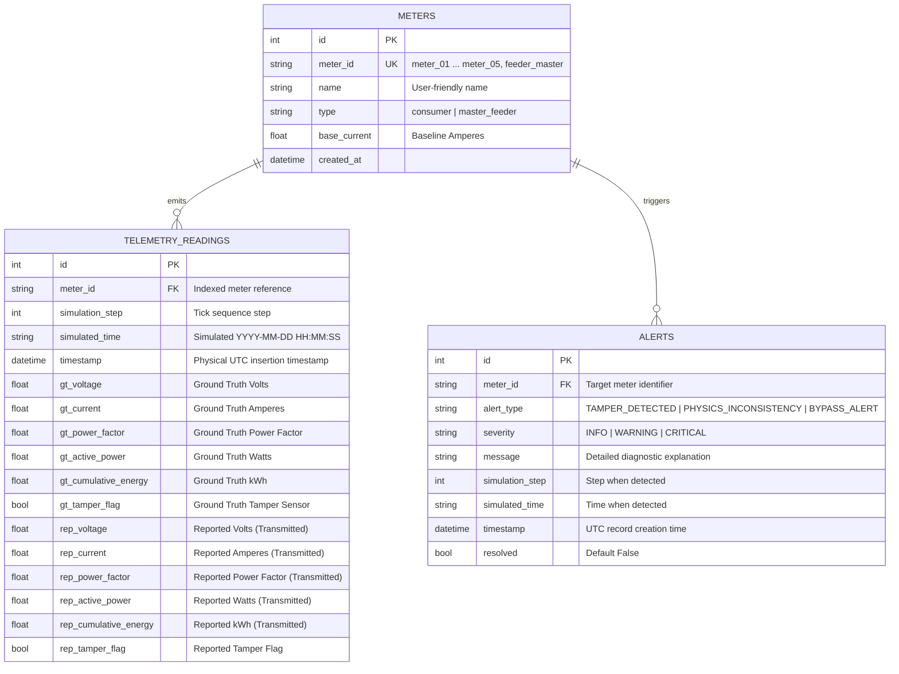
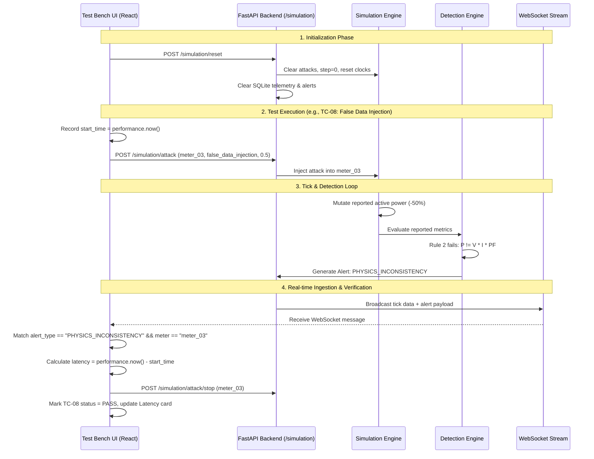

# IoT-Based Smart Energy Theft Monitoring & Cyber-Attack Detection System
## Comprehensive Technical Documentation & Conceptual Viva Guide

---

# TABLE OF CONTENTS
1. [SECTION 1: COMPLETE TECHNICAL SPECIFICATION & IMPLEMENTATION](#section-1-complete-technical-specification--implementation)
   - [1.1 System Architecture & Technical Stack](#11-system-architecture--technical-stack)
   - [1.2 Project File Structure & Responsibilities](#12-project-file-structure--responsibilities)
   - [1.3 Database Architecture & SQLite WAL Mode](#13-database-architecture--sqlite-wal-mode)
   - [1.4 REST API & WebSocket Communication Protocol](#14-rest-api--websocket-communication-protocol)
   - [1.5 Telemetry Simulation Mechanics & Numerical Modeling](#15-telemetry-simulation-mechanics--numerical-modeling)
   - [1.6 Rule-Based Anomaly & Theft Detection Engine](#16-rule-based-anomaly--theft-detection-engine)
   - [1.7 Frontend Dashboard & Test Bench Architecture](#17-frontend-dashboard--test-bench-architecture)
   - [1.8 System Setup & Execution Instructions](#18-system-setup--execution-instructions)
2. [SECTION 2: CONCEPTUAL FOUNDATIONS, METHODOLOGY & FEATURE WALKTHROUGH](#section-2-conceptual-foundations-methodology--feature-walkthrough)
   - [2.1 Problem Statement & Background: The Reality of Energy Theft](#21-problem-statement--background-the-reality-of-energy-theft)
   - [2.2 The Core Paradigm: Ground Truth vs. Reported Telemetry](#22-the-core-paradigm-ground-truth-vs-reported-telemetry)
   - [2.3 Deep Conceptual Breakdown of Every Attack Mode](#23-deep-conceptual-breakdown-of-every-attack-mode)
   - [2.4 How the Automated Test Bench Works (Viva Suite)](#24-how-the-automated-test-bench-works-viva-suite)
   - [2.5 Feature-by-Feature Conceptual Walkthrough of the User Interface](#25-feature-by-feature-conceptual-walkthrough-of-the-user-interface)
   - [2.6 Viva Voce Defense & Frequently Asked Questions (FAQ)](#26-viva-voce-defense--frequently-asked-questions-faq)

---

# SECTION 1: COMPLETE TECHNICAL SPECIFICATION & IMPLEMENTATION

### 1.1 System Architecture & Technical Stack

The system is a deterministic, localized simulation and cybersecurity testbed modeling an Advanced Metering Infrastructure (AMI) smart electricity grid. It decouples physical electricity generation/consumption from telemetry transport and rule evaluation.

```
+---------------------------------------------------------------------------------------+
|                                    PHYSICAL GRID LAYER                                |
|  [Master Grid Feeder]                                                                 |
|        |                                                                              |
|        +------> [Smart Meter 01 - Res. A]                                             |
|        +------> [Smart Meter 02 - Res. B]                                             |
|        +------> [Smart Meter 03 - Commercial]                                         |
|        +------> [Smart Meter 04 - Res. C]                                             |
|        +------> [Smart Meter 05 - Res. D]                                             |
+---------------------------------------------------------------------------------------+
                                           |
                                           v
+---------------------------------------------------------------------------------------+
|                           SIMULATION & CYBER-ATTACK ENGINE                            |
|  - Time Accelerator (1 sec real-time = 15 mins simulated)                             |
|  - Diurnal Load Curves (Peak / Normal / Night)                                        |
|  - Ground Truth Generator vs. Attack Mutator (Tamper / FDI / Bypass)                  |
+---------------------------------------------------------------------------------------+
                                           |
                                           v
+---------------------------------------------------------------------------------------+
|                         RULE-BASED DETECTION & PERSISTENCE                            |
|  - Rule 1: Hardware Enclosure Tamper Check                                            |
|  - Rule 2: Physics Consistency Equation: P = V * I * PF (1% margin)                   |
|  - Rule 3: Master Feeder vs. Sum of Meters Energy Balance (5% threshold, 3 ticks)     |
|  - Storage: SQLite in WAL (Write-Ahead Logging) Mode                                  |
+---------------------------------------------------------------------------------------+
                                           |
                   +-----------------------+-----------------------+
                   |                                               |
          (WebSocket Stream: 1 Hz)                        (REST Endpoints: HTTP)
                   |                                               |
                   v                                               v
+---------------------------------------------------------------------------------------+
|                                 REACT VITE DASHBOARD                                  |
|  - Real-Time Dual Metric Visualizer (Ground Truth vs Reported Active Power)           |
|  - Interactive Attack Injection Control Panel                                         |
|  - Phase 5 Automated Test Bench (TC-01, TC-03, TC-08 Latency Benchmark)                |
+---------------------------------------------------------------------------------------+
```

#### Technology Stack Components
| Layer | Technologies | Justification |
| :--- | :--- | :--- |
| **Backend Runtime** | Python 3.10+ / 3.13 | High standard library maturity, asyncio async loop support, scientific numerical simplicity. |
| **Backend Web Framework** | FastAPI (ASGI) | Native asynchronous WebSocket support, strict Pydantic type safety, auto-generated OpenAPI documentation. |
| **ASGI Server** | Uvicorn | High-performance asynchronous server capable of handling continuous real-time broadcast loops. |
| **Database ORM** | SQLModel (SQLAlchemy Core + Pydantic) | Single schema definition for both database storage and REST API validation. |
| **Database Engine** | SQLite (WAL Mode enabled) | Embedded zero-dependency database with Write-Ahead Logging to prevent lock contention between the continuous background worker and concurrent UI queries. |
| **Frontend Framework** | React 18 + Vite | Rapid Hot-Module-Replacement (HMR), declarative UI component tree, optimized single-page bundle. |
| **Language** | TypeScript 5 | Strict interface typing matching backend Pydantic models to prevent runtime schema mismatches. |
| **Styling** | Tailwind CSS | Utility-first styling for dark-mode telemetry dashboards with responsive grid layouts. |
| **Charting Engine** | Recharts (SVG-based) | Responsive dual-series line charts with dynamic interpolation and custom tooltips. |
| **Iconography** | Lucide React | Modern technical indicators for statuses, warnings, meters, and grid nodes. |

---

### 1.2 Project File Structure & Responsibilities

```
TY-CP-Iot--SMART-ENERGY-THEFT-DETECTION/
├── backend/
│   ├── database.py              # SQLite engine, connection pooling, and WAL PRAGMA setup
│   ├── detection.py             # RuleBased DetectionEngine evaluating incoming telemetry
│   ├── energy_simulation.db     # SQLite database file storing meters, readings, and alerts
│   ├── main.py                  # FastAPI server, simulation engine, WebSocket manager, attack routes
│   ├── models.py                # SQLModel table definitions (Meter, TelemetryReadings, Alerts)
│   └── requirements.txt         # Backend Python package requirements
├── frontend/
│   ├── index.html               # Web root entry point
│   ├── package.json             # NPM dependencies and build scripts
│   ├── postcss.config.js        # PostCSS pipeline for Tailwind CSS
│   ├── tailwind.config.js       # Color themes, fonts, and dark mode configuration
│   ├── tsconfig.json            # TypeScript compiler configuration
│   ├── vite.config.ts           # Vite configuration with proxy and dev server settings
│   └── src/
│       ├── App.tsx              # Monolithic UI containing Dashboard, Charts, Controls & Test Bench
│       ├── index.css            # Global CSS styles and Tailwind directives
│       └── main.tsx             # React root DOM mounting script
├── PROJECT_SPECIFICATION.docx   # Original project requirements document
├── README.md                    # Project readme file
├── run_steps.txt                # Quick reference start commands
└── PROJECT_DOCUMENTATION.md     # This comprehensive technical & conceptual guide
```

---

### 1.3 Database Architecture & SQLite WAL Mode

The database is built on top of SQLite using **SQLModel**. A critical technical challenge in real-time IoT monitoring is **database lock contention**: a background simulation thread writes telemetry batches every second, while the REST API and user queries read history asynchronously.

#### SQLite Concurrency Optimization (WAL Mode)
Standard SQLite locks the entire database file during write transactions. To eliminate `database is locked` exceptions, `backend/database.py` attaches event listeners that trigger on every engine connection:

```python
@event.listens_for(engine, "connect")
def set_sqlite_pragma(dbapi_connection, connection_record):
    cursor = dbapi_connection.cursor()
    cursor.execute("PRAGMA journal_mode=WAL;")
    cursor.execute("PRAGMA synchronous=NORMAL;")
    cursor.execute("PRAGMA busy_timeout=5000;")
    cursor.close()
```
- **`PRAGMA journal_mode=WAL;`**: Write-Ahead Logging allows simultaneous reads and writes. Readers do not block writers, and writers do not block readers.
- **`PRAGMA synchronous=NORMAL;`**: Reduces sync operations to critical disk checkpoints, drastically lowering I/O latency.
- **`PRAGMA busy_timeout=5000;`**: Configures a 5000 ms retry timeout before raising a lock error if a brief checkpoint occurs.
- **`connect_args={"check_same_thread": False}`**: Permits multiple async request workers to share database engine connections safely.

#### Database Tables Schema ([backend/models.py](file:///c:/Users/vaidi/OneDrive/Documents/Third%20Year/SEM%205/IOT/CP-IoT/TY-CP-Iot--SMART-ENERGY-THEFT-DETECTION/backend/models.py))



---

### 1.4 REST API & WebSocket Communication Protocol

#### REST API Endpoints Overview
| Method | Route | Description | Input Payload / Query | Output Format |
| :--- | :--- | :--- | :--- | :--- |
| `GET` | `/` | Health check and system metadata | None | JSON object with active attacks, step, clock, and connected clients. |
| `GET` | `/meters` | Fetch all configured smart meters | None | Array of meters with their latest reading and attack status. |
| `GET` | `/meters/{meter_id}/history` | Retrieve historical telemetry | `limit` (default: 50) | Array of chronological historical readings for charting. |
| `GET` | `/alerts` | Query detection alerts log | `limit` (default: 40), `resolved` (bool) | Array of triggered alerts sorted chronologically (latest first). |
| `POST` | `/alerts/clear` | Purge alerts database | None | `{"status": "cleared", "deleted_count": n}` |
| `POST` | `/simulation/attack` | Inject cyber or physical attack | `SimulationAttackRequest` | Attack confirmation object with meter ID, type, and intensity. |
| `POST` | `/simulation/attack/stop`| Halt ongoing attack | `StopAttackRequest` (meter_id optional) | Status confirmation of stopped attack. |
| `POST` | `/simulation/reset` | Global benchmark reset | None | Reset confirmation clearing database, steps, and attack states. |
| `GET` | `/simulation/attacks` | Query currently active attacks | None | Active attacks dictionary and count. |

#### WebSocket Telemetry Stream (`/ws/telemetry`)
- **Protocol**: Standard RFC 6455 WebSockets.
- **Frequency**: 1.0 Hz (1 tick per physical second).
- **Payload Structure**:
```json
{
  "timestamp": "2026-11-17T18:00:00.000000+00:00",
  "simulation_step": 142,
  "simulated_time": "2026-11-18 11:30:00",
  "time_compression": "1 sec = 15 mins",
  "active_attacks": {
    "meter_02": "false_data_injection"
  },
  "meters": {
    "meter_01": {
      "meter_id": "meter_01",
      "name": "Smart Meter 01 (Res. A)",
      "type": "consumer",
      "ground_truth": {
        "voltage": 229.4,
        "current": 5.42,
        "power_factor": 0.954,
        "active_power": 1186.2,
        "cumulative_energy": 125.82,
        "tamper_flag": false
      },
      "reported": {
        "voltage": 229.4,
        "current": 5.42,
        "power_factor": 0.954,
        "active_power": 1186.2,
        "cumulative_energy": 125.82,
        "tamper_flag": false
      },
      "active_attack": null
    },
    "feeder_master": { ... }
  },
  "alerts": [
    {
      "meter_id": "meter_02",
      "alert_type": "PHYSICS_INCONSISTENCY",
      "severity": "WARNING",
      "message": "Physics law violation on Smart Meter 02 (Res. B)! ...",
      "simulation_step": 142,
      "simulated_time": "2026-11-18 11:30:00"
    }
  ]
}
```

---

### 1.5 Telemetry Simulation Mechanics & Numerical Modeling

The simulation engine models a localized electrical distribution feeder and 5 downstream smart consumer meters.

#### 1. Time Compression
- **Ratio**: \(1\text{ second (wall-clock)} = 15\text{ minutes (simulated time)}\).
- **Step increment**: \(\Delta t = 0.25\text{ hours}\).
- **Diurnal cycle duration**: A complete 24-hour day completes in \(24 \times 4 = 96\text{ seconds}\). This enables rapid observation of load shifts and long-term cumulative energy divergence without waiting days.

#### 2. Diurnal Demand Profiles
To reflect authentic household energy use, consumer loads follow a time-dependent demand curve based on simulated hour \(H\):
$$\text{time\_factor} = \begin{cases} 
1.35 & \text{if } 18 \le H \le 22 \quad \text{(Evening Peak: Lighting, Cooking, HVAC)} \\
0.75 & \text{if } 1 \le H \le 5 \quad \text{(Night Slump: Sleeping, Minimal Idle Load)} \\
1.05 & \text{otherwise} \quad \text{(Daytime Baseline)}
\end{cases}$$

#### 3. Electrical Physics Model
Each meter's instantaneous load is calculated dynamically:
1. **Feeder Line Voltage**: Gaussian variation centered on standard Indian single-phase grid:
   $$V_{\text{feeder}} \sim \mathcal{N}(\mu=230.5\text{ V}, \sigma=0.8\text{ V})$$
2. **Line Voltage Drop**: Consumers downstream experience slight voltage attenuation due to wire impedance:
   $$V_{\text{consumer}} = V_{\text{feeder}} - \text{Uniform}(0.4\text{ V}, 1.8\text{ V})$$
3. **Current Draw**: Based on baseline appliance configuration and Gaussian noise:
   $$I_{\text{consumer}} = \max(0.5\text{ A}, \mathcal{N}(I_{\text{base}} \times \text{time\_factor}, \sigma_{I}))$$
4. **Power Factor (PF)**: Realistic inductive-resistive domestic load variation:
   $$\text{PF} \sim \text{Uniform}(0.92, 0.98)$$
5. **Physical Active Power (\(P\))**:
   $$P_{\text{true}} = V_{\text{consumer}} \times I_{\text{consumer}} \times \text{PF} \quad [\text{Watts}]$$
6. **Cumulative Energy Integration**:
   $$E_{\text{cum}}(t + \Delta t) = E_{\text{cum}}(t) + \frac{P_{\text{true}} \times \Delta t}{1000} \quad [\text{kWh}]$$

#### 4. Master Feeder Aggregation & Technical Distribution Losses
The Master Grid Feeder measures the aggregate physical energy pumped into the branch, incorporating a baseline **3% Technical Distribution Loss** (\(\alpha = 0.03\)) due to ohmic resistance in distribution cabling:
$$P_{\text{feeder}} = \left(\sum_{k=1}^{5} P_{\text{true}, k}\right) \times (1.0 + \alpha)$$
$$I_{\text{feeder}} = \frac{P_{\text{feeder}}}{V_{\text{feeder}} \times \text{PF}_{\text{feeder}}}$$

---

### 1.6 Rule-Based Anomaly & Theft Detection Engine

The detection engine ([backend/detection.py](file:///c:/Users/vaidi/OneDrive/Documents/Third%20Year/SEM%205/IOT/CP-IoT/TY-CP-Iot--SMART-ENERGY-THEFT-DETECTION/backend/detection.py)) strictly consumes **Reported Data** only. It has zero knowledge of Ground Truth values, mirroring real-world grid sub-station server constraints.

```mermaid
flowchart TD
    A[Incoming Telemetry Batch] --> B[Parse Reported Telemetry for Each Meter]
    
    B --> C{Rule 1: Tamper Flag == True?}
    C -- Yes --> D[Trigger CRITICAL Alert: TAMPER_DETECTED]
    C -- No --> E{Rule 2: Physics Check |P - V*I*PF| / (V*I*PF) > 1%?}
    
    E -- Yes --> F[Trigger WARNING Alert: PHYSICS_INCONSISTENCY]
    E -- No --> G[Accumulate Consumer Reported Power & Energy]
    
    D --> G
    F --> G
    
    G --> H[Calculate Feeder Discrepancy: Feeder - Sum_Consumer]
    H --> I{Rule 3: Imbalance > 5%?}
    I -- Yes --> J[Increment consecutive_imbalance_ticks]
    I -- No --> K[Reset consecutive_imbalance_ticks = 0]
    
    J --> L{Ticks >= 3?}
    L -- Yes --> M[Trigger CRITICAL Alert: BYPASS_ALERT]
    L -- No --> N[No Bypass Alert Yet - Debouncing Window]
```

#### Detailed Rule Formulations

| Rule | Formal Mathematical Criterion | Severity | Debounce / Persistence | Diagnostic Target |
| :--- | :--- | :--- | :--- | :--- |
| **Rule 1: Physical Tamper Sabotage** | $$\text{rep\_tamper\_flag} == \text{True}$$ | `CRITICAL` | Immediate (1 tick) | Physical box opening, magnetic field interference, enclosure switch tripping. |
| **Rule 2: Physics Law Inconsistency** | $$\frac{|P_{\text{rep}} - (V_{\text{rep}} \times I_{\text{rep}} \times \text{PF}_{\text{rep}})|}{V_{\text{rep}} \times I_{\text{rep}} \times \text{PF}_{\text{rep}}} > 0.01$$ | `WARNING` | Immediate (1 tick) | False Data Injection (FDI), firmware hacking, scalar bill-reduction attacks. |
| **Rule 3: Distribution Feeder Imbalance** | $$\frac{P_{\text{feeder}} - \sum_{k=1}^{n} P_{\text{rep}, k}}{P_{\text{feeder}}} > 0.05$$ | `CRITICAL` | Sustained for \(\ge 3\) consecutive ticks | Physical meter bypass, line tapping before meter terminals, illegal neutral loop. |

---

### 1.7 Frontend Dashboard & Test Bench Architecture

The frontend is constructed with high-efficiency modular components in [frontend/src/App.tsx](file:///c:/Users/vaidi/OneDrive/Documents/Third%20Year/SEM%205/IOT/CP-IoT/TY-CP-Iot--SMART-ENERGY-THEFT-DETECTION/frontend/src/App.tsx).

```
+---------------------------------------------------------------------------------------+
|  Top Header: System Title | Phase Badge | Sim Clock | Connection Status Indicator    |
+---------------------------------------------------------------------------------------+
|  Tab Navigation: [ Live Dashboard ]  |  [ Test Bench (Viva Mode) ]                   |
+---------------------------------------------------------------------------------------+
|  TAB 1: LIVE DASHBOARD                                                                |
|  +-----------------------------------+  +-------------------------------------------+ |
|  | Master Grid Feeder High-Load Card |  | 5 Consumer Smart Meter Cards              | |
|  | Total Load, Voltage, Cumulative   |  | Reported vs Ground Truth, Status Badges   | |
|  +-----------------------------------+  +-------------------------------------------+ |
|  +----------------------------------------------------------------------------------+ |
|  | Real-Time Dual-Series Recharts (Active Power: Reported [Cyan] vs Ground Truth [Gold]) | |
|  +----------------------------------------------------------------------------------+ |
|  +-----------------------------------+  +-------------------------------------------+ |
|  | Attack Injection Control Panel    |  | Real-Time Security Alerts Log             | |
|  | Meter, Attack Mode, Slider, Fire  |  | Filter: All / Critical / Warning, Clear   | |
|  +-----------------------------------+  +-------------------------------------------+ |
+---------------------------------------------------------------------------------------+
|  TAB 2: AUTOMATED TEST BENCH (VIVA SUITE)                                             |
|  +----------------------------------------------------------------------------------+ |
|  | Benchmark Summary: Pass Rate %, Total Executed, Average Detection Latency (ms)   | |
|  +----------------------------------------------------------------------------------+ |
|  | Test Scenario Cards: [TC-03: Bypass] [TC-08: False Data] [TC-01: Tamper Sabotage] | |
|  | Run Single Test / Run Entire Automated Suite / Reset Database & Benchmark        | |
+---------------------------------------------------------------------------------------+
```

---

### 1.8 System Setup & Execution Instructions

#### Prerequisites
- **Python**: Version 3.10 to 3.13 (`python --version`)
- **Node.js**: Version 18+ (`node -v`, `npm -v`)

#### Step-by-Step Execution Guide

##### Terminal 1: Backend Server
```powershell
cd backend
python -m pip install -r requirements.txt
python -m uvicorn main:app --reload --port 8000
```
*The backend starts at `http://localhost:8000`. Swagger API docs are accessible at `http://localhost:8000/docs`.*

##### Terminal 2: Frontend Dashboard
```powershell
cd frontend
npm install
npm run dev
```
*The Vite frontend starts at `http://localhost:3000`.*

---

# SECTION 2: CONCEPTUAL FOUNDATIONS, METHODOLOGY & FEATURE WALKTHROUGH

### 2.1 Problem Statement & Background: The Reality of Energy Theft

#### The Magnitude of Non-Technical Losses (NTL)
In electrical power distribution systems, losses are categorized into two distinct classes:
1. **Technical Losses (TL)**: Inherent physical dissipation of electrical energy as heat in conductors, transformers, and switchgear (\(I^2 R\) losses). These are unavoidable laws of thermodynamics and typically account for 2% to 4% of well-maintained distribution networks.
2. **Non-Technical Losses (NTL)**: Losses caused by external human actions, predominantly **energy theft**, physical meter tampering, cyber-attacks on smart metering infrastructure, billing errors, and unmetered illegal connections.

In developing power markets, NTL often exceeds **15% to 25%** of generated energy. This causes:
- Multi-billion dollar annual financial deficits for public and private electricity distribution companies (DISCOMs).
- Unplanned feeder overloading, leading to local distribution transformer burnouts and blackouts.
- Increased tariffs on paying, honest consumers to subsidize unmetered consumption.

#### The Smart Grid Vulnerability Paradox
The global deployment of Advanced Metering Infrastructure (AMI) smart meters was intended to eliminate energy theft by replacing physical human meter readers with automated cellular/RF telemetry. However, smart meters introduced a new attack surface: **cyber-physical attacks**. If a malicious actor compromises the firmware or network packets of an IoT smart meter, they can artificially report suppressed energy consumption while continuing to draw high physical power from the grid.

This project was built to address this exact challenge by providing a **transparent, physics-informed, rule-based cyber-physical testbed**.

---

### 2.2 The Core Paradigm: Ground Truth vs. Reported Telemetry

The foundational intellectual principle of this project is the **strict philosophical and architectural decoupling of Ground Truth from Reported Telemetry**.

```
+-------------------------------------------------------------+
|                      PHYSICAL UNIVERSE                      |
|                  (Ground Truth Telemetry)                   |
|                                                             |
|  - Real electrons passing through copper cables             |
|  - Real magnetic flux, current draw, and power dissipation  |
|  - Inviolable laws of physics (P = V * I * PF)              |
|  - Measured upstream by the Master Grid Transformer         |
+-------------------------------------------------------------+
                              |
                     [Attacker Intrusion]
                     - Physical bypass wire
                     - Injected corrupted payload
                     - Firmware active power scalar
                              |
                              v
+-------------------------------------------------------------+
|                      CYBER / IOT UNIVERSE                   |
|                    (Reported Telemetry)                     |
|                                                             |
|  - The digitized byte stream sent over MQTT / WebSockets    |
|  - Can be fabricated, zeroed, tampered, or scaled           |
|  - What the utility billing system traditionally sees       |
+-------------------------------------------------------------+
```

#### Why Decoupling is Essential
1. **In a physical grid without ground truth sensors**, a utility only sees what the meter reports. If a consumer hacks their meter to report 0 Amperes, the billing computer simply assumes the house is vacant.
2. **In this simulation testbed**, the engine maintains the true physical reality (`ground_truth`) alongside the transmitted packet (`reported`).
3. **The Detection Engine is deliberately blindfolded**: It is granted access **strictly to reported data and feeder aggregate data**. It must discover the theft using physical principles and conservation of energy.

---

### 2.3 Deep Conceptual Breakdown of Every Attack Mode

The project implements three distinct, representative threat vectors reflecting real-world energy theft techniques:

```mermaid
graph TD
    subgraph ATK1 [1. Physical Tamper Sabotage]
        T1[Physical Action: Magnet or Box Breach] --> T2[Hardware Sensor Closes: tamper_flag = True]
        T2 --> T3[Rule 1 Detection: Immediate CRITICAL Alert]
    end

    subgraph ATK2 [2. False Data Injection - FDI]
        F1[Cyber Action: Modify Reported Power P by 50%] --> F2[Voltage V and Current I Remain Normal]
        F2 --> F3[Math Breakdown: P != V * I * PF]
        F3 --> F4[Rule 2 Detection: WARNING Alert - Physics Inconsistency]
    end

    subgraph ATK3 [3. Meter Physical Bypass]
        B1[Physical Action: Jumper Cable Across Terminals] --> B2[Meter Measures Nothing: I_rep=0, P_rep=0]
        B2 --> B3[Feeder Delivers Load to Grid: Feeder Stays High]
        B3 --> B4[Energy Deficit: Feeder - Sum_Meters > 5%]
        B4 --> B5[Rule 3 Detection: 3 Ticks Debounce -> CRITICAL Bypass Alert]
    end
```



#### 1. Attack Vector 1: Physical Tamper Sabotage (`trigger_tamper`)
- **Real-World Mechanism**: Consumers frequently attempt to disrupt the inductive coils or Hall-effect sensors inside electronic meters using high-strength neodymium magnets, or they open the meter casing to modify the internal circuitry.
- **IoT Countermeasure**: Modern smart meters are equipped with optical enclosure micro-switches and Hall-effect magnetic flux sensors powered by an internal lithium backup coin battery.
- **Simulation Behavior**: The attacker triggers the tamper switch. The meter payload transmits `tamper_flag = True`.
- **Detection Logic**: Rule 1 triggers an immediate `CRITICAL` alert: `"Tamper sensor triggered on Smart Meter XX! Physical enclosure or magnetic field breach detected."`

#### 2. Attack Vector 2: False Data Injection / FDI (`false_data_injection`)
- **Real-World Mechanism**: A cyber-attack where the attacker gains root access to the smart meter microcontroller (via optical port or RF/Zigbee interface) or intercepts the network transmission. Rather than zeroing the bill (which would attract suspicion), the attacker cuts the reported power by a fraction (e.g., 50%) to subtly reduce their electricity bill month after month.
- **The Attacker's Fatal Mistake**: A naive hacker modifies only the `Active Power (W)` field, leaving the raw `Voltage (V)`, `Current (A)`, and `Power Factor (PF)` measurements untouched because modifying all correlated physical variables consistently requires solving non-linear AC circuit equations in real time.
- **Simulation Behavior**:
  $$\text{Reported Active Power} = P_{\text{true}} \times (1.0 - \text{intensity})$$
  $$\text{Reported Voltage} = V_{\text{true}}, \quad \text{Reported Current} = I_{\text{true}}, \quad \text{Reported PF} = \text{PF}_{\text{true}}$$
- **Detection Logic**: Rule 2 tests the fundamental AC active power equation:
  $$P_{\text{expected}} = V_{\text{reported}} \times I_{\text{reported}} \times \text{PF}_{\text{reported}}$$
  If \(|P_{\text{reported}} - P_{\text{expected}}| / P_{\text{expected}} > 0.01\) (1% tolerance), the engine immediately exposes the fraud: `"Physics law violation on Smart Meter XX! Reported P=XXX.X W deviates from V*I*PF=YYY.Y W by ZZ.Z%."`

#### 3. Attack Vector 3: Physical Meter Wiring Bypass (`bypass`)
- **Real-World Mechanism**: The consumer installs a physical bridging wire (jumper) connecting the incoming service line directly to the home distribution board, bypassing the current sensing element of the meter entirely.
- **The Meter's View**: The meter current drops to \(0\text{ A}\) and power drops to \(0\text{ W}\). To the local meter, it appears as though all home appliances are switched off.
- **The Grid's View (Law of Conservation of Energy)**: The appliances are still consuming physical electricity. That power must originate from the distribution transformer (the Master Feeder).
- **Simulation Behavior**:
  $$\text{Consumer Reported Current} = 0.0\text{ A}, \quad \text{Consumer Reported Power} = 0.0\text{ W}$$
  $$\text{Master Feeder Power} = \sum P_{\text{true}} \times (1.03) \quad (\text{Remains High!})$$
- **Detection Logic (Macro Energy Balance & Debouncing)**:
  Rule 3 calculates the feeder discrepancy:
  $$\Delta P = P_{\text{feeder}} - \sum_{k=1}^{5} P_{\text{reported}, k}$$
  If \(\Delta P / P_{\text{feeder}} > 0.05\) (5% threshold, safely above 3% technical cable losses):
  - **Debouncing Requirement**: Sudden appliance switching or motor inrush currents can cause momentary 1-second imbalances. To prevent false positives, Rule 3 requires the imbalance to persist for **3 consecutive ticks (representing 45 simulated minutes)**.
  - On the 3rd consecutive tick, it fires a `CRITICAL` alert: `"Grid bypass detected! Master feeder load exceeds aggregate consumer readings by XX.X% for 3 consecutive intervals."`

---

### 2.4 How the Automated Test Bench Works (Viva Suite)

The **Automated Test Bench (Viva Mode)** provides an automated, reproducible testing environment for examiners to verify the system's performance metrics:



#### Test Suite Matrix
| Test Case ID | Test Case Title | Target Meter | Injected Attack | Expected Alert Signature | Success Criteria |
| :--- | :--- | :--- | :--- | :--- | :--- |
| **TC-01** | Physical Tamper Sabotage | `meter_02` | `trigger_tamper` | `TAMPER_DETECTED` (Severity: `CRITICAL`) | Alert received with matching meter ID and enclosure violation message within 8500 ms. |
| **TC-03** | Simulated Meter Bypass | `meter_01` | `bypass` | `BYPASS_ALERT` (Severity: `CRITICAL`) | Alert received indicating Feeder > 5% above sum of meters after 3 consecutive ticks. |
| **TC-08** | False Data Injection (FDI) | `meter_03` | `false_data_injection` (50%) | `PHYSICS_INCONSISTENCY` (Severity: `WARNING`) | Alert received flagging active power deviation from \(V \times I \times \text{PF}\). |

#### Measured Evaluation Metrics
1. **Detection Latency (ms)**: High-resolution wall-clock duration between the REST attack invocation and the exact millisecond the corresponding alert is parsed from the WebSocket stream.
2. **True Positive Rate / Pass Rate (%)**: \(\frac{\text{Passed Tests}}{\text{Total Executed Tests}} \times 100\).
3. **Debounce Verification**: Confirms that transient noise does not trigger false alerts, while sustained anomalies are detected within the defined time window.

---

### 2.5 Feature-by-Feature Conceptual Walkthrough of the User Interface

#### 1. Real-Time Telemetry Header & Status Badges
- **Simulated Clock**: Shows accelerated grid time (\(1\text{s} = 15\text{m}\)). Allows observing day-to-night transitions.
- **Connection Pill**: Green pulsing indicator confirms live WebSocket transport. Automatically attempts reconnection every 3 seconds if disconnected.

#### 2. Master Feeder vs. Consumer Grid Cards
- **Master Grid Feeder Card**: Displayed on the left with prominent purple/indigo accents. Shows the total aggregate power drawn by the entire neighborhood plus technical cable loss.
- **Consumer Meter Cards**: 5 distinct cards representing residential and commercial subscribers. Each card displays:
  - Live Reported Voltage (\(\text{V}\)), Current (\(\text{A}\)), Power Factor, and Active Power (\(\text{W}\)).
  - Attack status badges (e.g., `Bypass Active (0W)`, `FDI Active (-50%)`, `Tamper Injected`).
  - Active selection highlight: Clicking any meter routes its live stream into the main comparison chart.

#### 3. Dual-Series Recharts Visualizer
- **Reported Power Line (Cyan)**: Illustrates the metric transmitted by the IoT meter.
- **Ground Truth Power Line (Amber/Gold)**: Illustrates the physical energy consumed.
- **Visual Attack Divergence**:
  - In normal conditions, the Cyan and Gold lines overlap.
  - When False Data Injection is activated, the Cyan line drops to 50%, while the Gold line remains high.
  - When Bypass is activated, the Cyan line drops to zero, visually exposing the theft.

#### 4. Attack Injection Control Panel
- **Target Selector**: Allows picking any of the 5 consumer meters.
- **Intensity Slider**: Adjusts attack magnitude from 10% to 90% (for False Data Injection).
- **Direct Attack Buttons**: One-click triggering of Tamper Sabotage, False Data Injection, or Wiring Bypass.
- **Stop Button**: Clears active attacks, restoring normal meter reporting.

#### 5. Real-Time Security Alerts Log
- Displays alerts with timestamps, simulation steps, severity chips (`CRITICAL` in crimson, `WARNING` in amber), and diagnostic messages.
- Filterable by `ALL`, `CRITICAL`, or `WARNING`. Includes a one-click button to purge alerts from the database.

---

### 2.6 Viva Voce Defense & Frequently Asked Questions (FAQ)

Here are the most critical questions external examiners typically ask during viva examinations, along with model technical answers:

#### Q1: "Why did you use a Rule-Based Detection Engine instead of Machine Learning (ML)?"
> **Answer**:  
> In electrical grid protection and billing fraud detection, **explainability and latency** are critical. Machine learning models (like Random Forests, Autoencoders, or Isolation Forests) operate as "black boxes" that require large, labeled training datasets, suffer from concept drift when consumer load habits change, and can generate false positives due to benign anomalies (like purchasing a new air conditioner).  
> In contrast, our rule-based engine relies on **inviolable physical laws**:
> 1. An electrical meter cannot report \(1000\text{W}\) when \(230\text{V} \times 10\text{A} \times 0.95 = 2185\text{W}\). This is a mathematical impossibility governed by the laws of alternating current.
> 2. Energy cannot disappear between a distribution transformer and its 5 downstream meters; conservation of energy dictates that any substantial, persistent deficit is non-technical loss.  
> Our rules provide deterministic, zero-latency detection with zero false positives under honest conditions and produce human-understandable diagnostic messages.

#### Q2: "How does the system prevent false alarms caused by normal line losses or motor startup currents?"
> **Answer**:  
> We incorporated two specific engineering mechanisms:
> 1. **Tolerance Margins**: We configured a **3% baseline technical distribution loss** in the physical model and set the Feeder Imbalance detection threshold at **5%**, preventing normal line impedance losses from triggering alerts.
> 2. **Temporal Debouncing (Consecutive Ticks)**: Motor startup currents (e.g., compressor starting) can cause momentary 1-second power spikes. Rule 3 requires the energy imbalance to persist for **3 consecutive ticks (45 simulated minutes)** before escalating to a `CRITICAL` bypass alert, effectively filtering out transient electrical noise.

#### Q3: "What is the significance of SQLite WAL (Write-Ahead Logging) mode in this project?"
> **Answer**:  
> Standard SQLite locks the entire database file during write operations. Because our simulation loop writes telemetry batches every second while the frontend concurrently queries historical readings and active alerts via REST, standard SQLite would frequently throw `database is locked` exceptions.  
> By enabling WAL mode (`PRAGMA journal_mode=WAL`), SQLite writes new records to a separate `-wal` log file. This enables **concurrent readers and writers**: the background simulation worker writes telemetry without blocking user API reads, ensuring smooth dashboard operation.

#### Q4: "Why is the simulation accelerated to 1 second = 15 minutes?"
> **Answer**:  
> Energy theft patterns, particularly meter bypass and unmetered consumption, are long-term cumulative phenomena evaluated over hours and billing cycles. If the simulation ran in real time (1:1), an examiner would have to wait 6 to 12 hours to observe cumulative kilowatt-hour divergence. With our time compression factor of 900x (\(1\text{s} = 15\text{m}\)), an entire 24-hour diurnal cycle elapses in 96 seconds, allowing rapid demonstration of diurnal demand curves, attack impacts, and recovery.

#### Q5: "How does your system distinguish between a household with appliances turned off versus a meter bypass attack?"
> **Answer**:  
> If an honest household turns off all appliances, both the meter's reported load drops to near-zero **and** the Master Feeder's physical load drops proportionally.  
> In a bypass attack, the consumer meter reports zero, but the physical appliances are still drawing power from the distribution transformer. The Master Feeder continues measuring this high physical draw, creating a substantial numerical deficit between the feeder measurement and the sum of consumer readings, exposing the bypass via Rule 3.

---

*Document compiled for academic presentation, software engineering review, and viva defense evaluation.*

